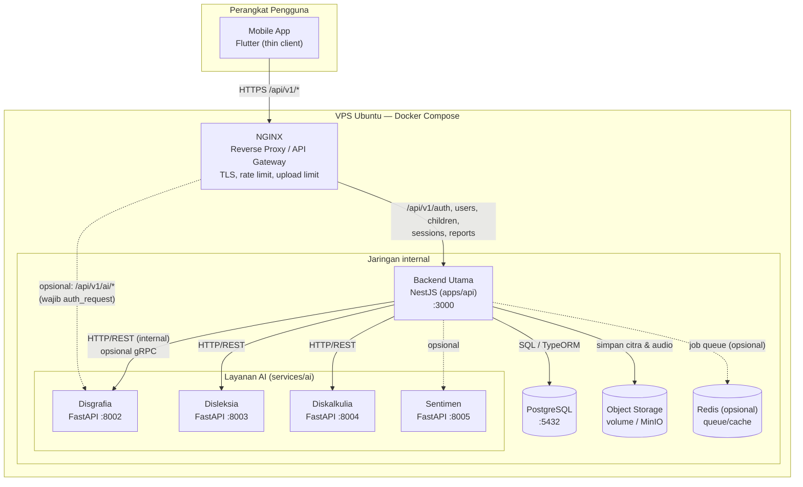
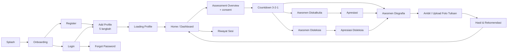
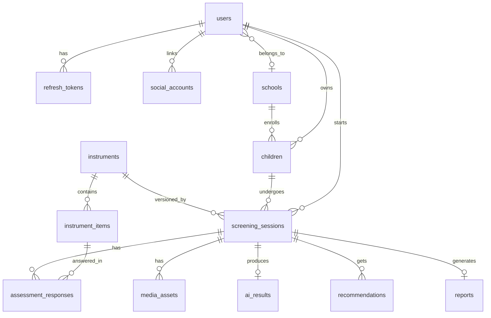
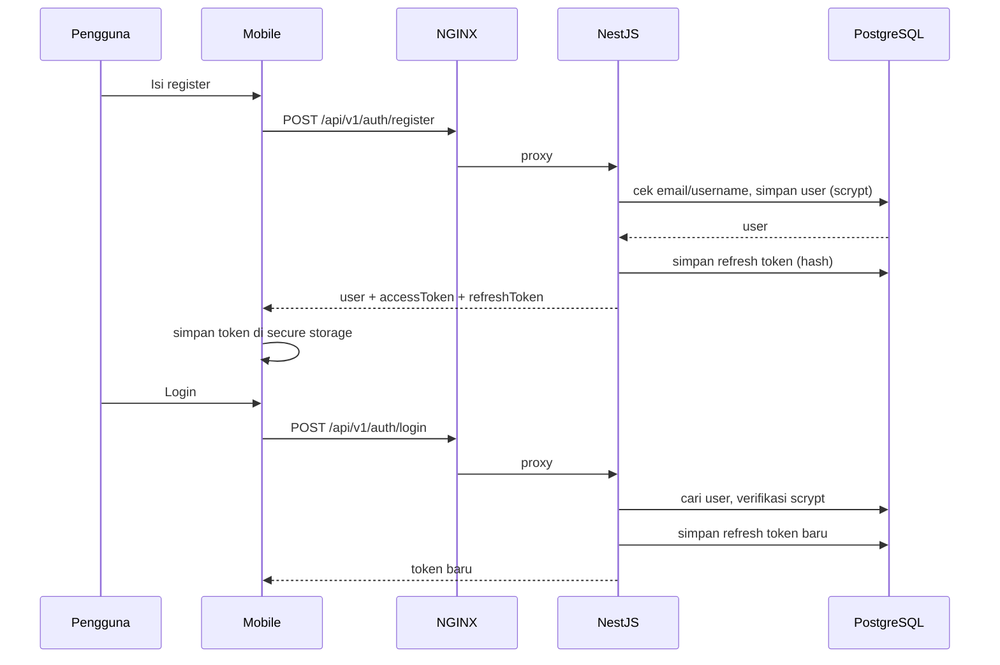
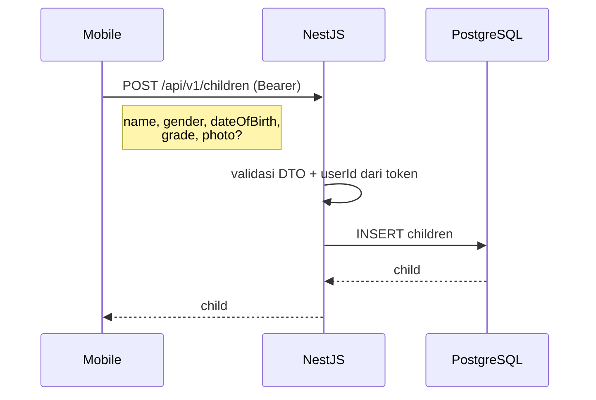
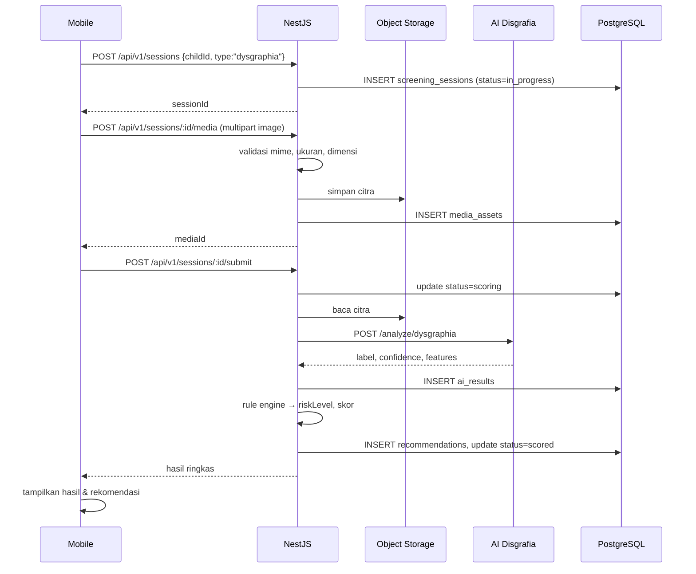
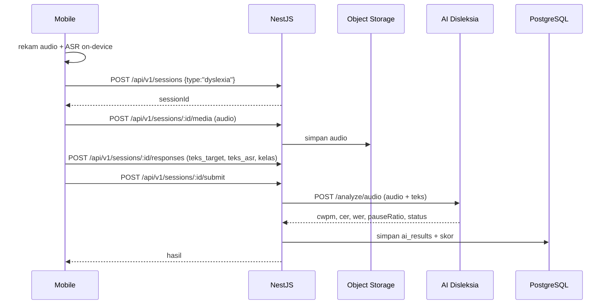
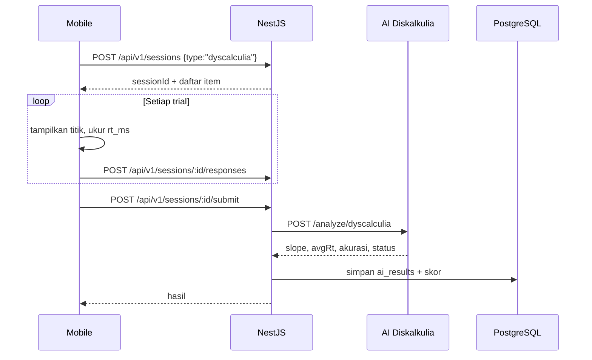
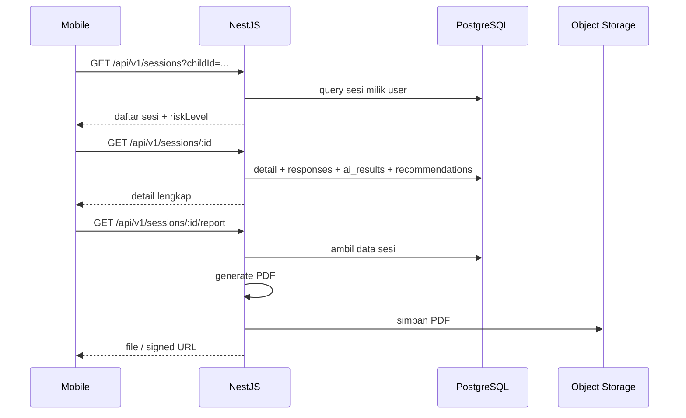

# Desain Arsitektur Sistem KAWANTUMBUH

> Dokumen ini adalah rancangan teknis sistem **KAWANTUMBUH** — Sistem Pemantauan Perkembangan dan Stimulasi Terpadu untuk Penanganan Dini Gejala *Specific Learning Disorder* (SLD) pada anak usia dasar (disleksia, disgrafia, diskalkulia).
>
> Dasar penyusunan: struktur repository saat ini (`apps/`, `services/`, `infra/`, `docs/`, `tests/`, `scripts/`) dan diagram topologi referensi **“DESAIN SISTEM & TOPOLOGI KAWANTUMBUH”**.
>
> Dokumen ini membedakan secara eksplisit antara **kondisi saat ini (as-is)**, **target arsitektur (to-be)**, dan **gap yang harus dikerjakan**.

---

## 1. Ringkasan Eksekutif

KAWANTUMBUH dirancang sebagai **modular monolith + AI sidecar services**:

- **Mobile app (Flutter)** sebagai *thin client*: hanya menangani UI, input kuesioner, perekaman audio, dan pengambilan foto tulisan tangan.
- **API Gateway (NGINX)** sebagai satu-satunya pintu masuk publik: terminasi TLS, routing, rate limiting, dan pembatasan ukuran upload.
- **Backend utama (NestJS)** di `apps/api`: sumber kebenaran untuk autentikasi, data orang tua/anak/sekolah, sesi asesmen, aturan skor, rekomendasi, riwayat, dan laporan.
- **Database PostgreSQL** sebagai penyimpanan transaksional utama.
- **Layanan AI (FastAPI, Python)** di `services/ai`: inference disgrafia (computer vision), skrining disleksia (audio + rule-based), skrining diskalkulia (reaction time + rule-based), dan analisis sentimen (opsional).
- **Object storage** untuk citra tulisan tangan dan rekaman audio (volume lokal untuk MVP, MinIO/S3 untuk produksi).
- **Docker Compose di VPS Ubuntu** sebagai target deployment, dengan hanya NGINX yang terekspos ke internet.

Prinsip utamanya: **mobile tidak pernah memanggil layanan AI secara langsung tanpa otorisasi**, **semua data anak melewati backend**, dan **setiap hasil AI disimpan bersama versi model serta fitur yang mendasarinya** agar dapat diaudit dan dijelaskan (*explainable AI*).

---

## 2. Tujuan Arsitektur

1. **Fungsional**
   - Orang tua dapat mendaftar, login, dan mengelola profil anak.
   - Anak/orang tua dapat menjalankan tiga modul skrining: disleksia, disgrafia, diskalkulia.
   - Sistem menyimpan riwayat asesmen dan menampilkan perkembangan antar sesi.
   - Sistem menghasilkan hasil skrining, tingkat risiko, dan rekomendasi stimulasi.
   - Sistem menghasilkan laporan yang dapat dibaca orang tua/guru.

2. **Non-fungsional**
   - Aman untuk data anak (UU PDP No. 27/2022).
   - Cukup ringan untuk VPS kecil (2 vCPU / 4 GB) dan dapat diskalakan.
   - AI inference berjalan di CPU tanpa GPU, target < 2 detik per permintaan.
   - Dapat diuji: unit, integration, contract, e2e, dan load test.
   - Dapat di-deploy ulang secara konsisten (container + migration + seed).

3. **Akademik (capstone 7 mata kuliah)**
   - Setiap mata kuliah memiliki artefak yang jelas di repository.
   - Arsitektur memisahkan concern sehingga tiap anggota tim dapat bekerja paralel tanpa konflik besar.

---

## 3. Prinsip & Keputusan Arsitektur

| # | Prinsip | Alasan |
|---|---|---|
| P1 | **Modular monolith dulu, microservice hanya untuk AI** | Tim 4 orang, 3 bulan. Satu deployable backend lebih murah dirawat daripada banyak service bisnis. |
| P2 | **Thin client** | Mobile hanya UI + input sensor. Logika skor dan rekomendasi tidak boleh diduplikasi di client agar konsisten. |
| P3 | **Backend sebagai orkestrator AI** | Auth, audit, penyimpanan hasil, dan validasi tetap di backend. AI tidak diberi akses langsung ke database. |
| P4 | **Contract-first** | OpenAPI untuk REST dan skema JSON/Pydantic untuk AI. Perubahan kontrak harus lewat review. |
| P5 | **Explainable result** | Simpan fitur/probabilitas/versi model, bukan hanya label akhir. |
| P6 | **Privacy by design** | Data minimization, consent tercatat, retensi terbatas, akses berbasis kepemilikan. |
| P7 | **Stateless API** | Access token JWT, session state di database. API bisa di-scale horizontal. |
| P8 | **Fail gracefully** | Jika AI down, sesi tetap tersimpan dan dapat di-retry; client mendapat status `pending`, bukan error kehilangan data. |
| P9 | **REST/JSON untuk MVP, gRPC opsional** | Diagram menyebut HTTP/REST & gRPC. Untuk 3 bulan, REST cukup; gRPC disiapkan sebagai jalur optimasi internal. |
| P10 | **Infrastructure as code ringan** | Docker Compose + `.env` + script deploy; tidak perlu Kubernetes untuk skala capstone. |

---

## 4. Topologi Sistem (Target)

### 4.1 Diagram deployment



### 4.2 Peta komponen

| Komponen | Lokasi repo | Teknologi | Tanggung jawab | Status |
|---|---|---|---|---|
| Mobile app | `apps/mobile/kawan_tumbuh` | Flutter, Dart | UI, form, kamera, mikrofon, navigasi, pemanggilan API | Sebagian (UI saja) |
| API Gateway | `infra/nginx` (belum ada) | NGINX | TLS, routing, rate limit, limit upload, header keamanan | Belum ada |
| Backend API | `apps/api` | NestJS 12, TypeORM, PostgreSQL | Auth, users, children, sesi, skor, rekomendasi, laporan | Sebagian (auth/users/children) |
| Database | `infra` / service `postgres` | PostgreSQL 16 | Data transaksional | Sebagian (5 tabel) |
| AI disgrafia | `services/ai/dysgraphia` | Python, FastAPI, scikit-learn, OpenCV, scikit-image | Ekstraksi 25 fitur grafologi + klasifikasi RF | Pipeline ada, **belum FastAPI** |
| AI disleksia | `services/ai/dyslexia` | FastAPI, librosa, jiwer | CER/WER, CWPM, pause ratio, rule-based | Ada |
| AI diskalkulia | `services/ai/dyscalculia` | FastAPI, NumPy | Subitizing slope, RT, akurasi, rule-based | Ada |
| AI sentimen | `services/ai/sentiment` | FastAPI, pickle | Analisis teks catatan orang tua (opsional) | Ada, belum terhubung |
| Object storage | `infra` (belum ada) | Volume Docker / MinIO | Citra tulisan tangan, audio | Belum ada |
| Testing | `tests/`, `apps/*/test` | Vitest, Flutter test, k6, Newman | Unit, e2e, load, contract | Kerangka kosong |
| Scripts | `scripts/` | Node/Python/Shell | Seed instrumen, backup, utilitas | Kosong |
| Docs | `docs/` | Markdown, OpenAPI, Postman | Kontrak API, instrumen, laporan | Sebagian |

---

## 5. Detail Komponen

### 5.1 Mobile App (Flutter)

#### 5.1.1 Peran

Mobile adalah **thin client**: tidak menghitung skor akhir, tidak menyimpan keputusan klinis, dan tidak memiliki secret AI. Mobile hanya:

1. Mengumpulkan input (jawaban kuesioner, jumlah titik, waktu reaksi, rekaman suara, foto tulisan).
2. Mengirim ke backend melalui HTTPS.
3. Menampilkan hasil, riwayat, dan rekomendasi dari backend.

#### 5.1.2 Struktur folder saat ini

```text
lib/
├── main.dart
├── core/
│   ├── constants/        # app_assets, app_colors, app_constants
│   ├── theme/            # app_text_styles
│   └── utils/            # responsive
├── models/               # child_profile
├── screens/
│   ├── splash, onboarding, login, register, forgot_password
│   ├── add_profile/      # step_name, step_gender, step_class,
│   │                     # step_date_of_birth, step_avatar
│   ├── loading_profile
│   ├── assessment_overview, countdown
│   ├── assessment_dyscalculia, assessment_dyslexia
│   ├── assessment_dysgraphia_intro
│   └── apresiasi, apresiasi_dyslexia
└── widgets/              # primary_button, step_header, step_title
```

#### 5.1.3 Struktur target (refactor bertahap)

```text
lib/
├── main.dart
├── app.dart
├── core/
│   ├── config/           # API_BASE_URL, flavor, timeout
│   ├── network/          # dio client, auth interceptor, refresh queue
│   ├── storage/          # secure storage, local cache
│   ├── constants/
│   ├── theme/
│   └── utils/
├── data/
│   ├── api/              # auth_api, children_api, sessions_api
│   ├── dto/              # request/response model
│   ├── repositories/     # AuthRepository, ChildRepository, ...
│   └── local/            # pending upload queue
├── domain/
│   └── entities/         # User, Child, Session, ScreeningResult
├── features/
│   ├── auth/
│   ├── child/
│   ├── assessment/
│   ├── result/
│   ├── history/
│   └── profile/
└── shared/widgets/
```

Refactor tidak harus sekaligus. Prioritas: pindahkan `screens/` yang sudah ada ke `features/` ketika fitur tersebut mulai terhubung ke API.

#### 5.1.4 Alur layar (as-is dan target)



Catatan kondisi saat ini:

- `Home` masih `PlaceholderHomePage`.
- `Add Profile` mengumpulkan `kelas` tetapi **belum dikirim ke backend**; entity `children` belum punya kolom `grade`.
- `AssessmentDyscalculiaScreen` masih 1 soal contoh dan belum menyimpan jawaban/RT.
- `AssessmentDyslexiaScreen` masih 1 kalimat contoh, animasi waveform palsu, dan belum merekam audio nyata.
- `AssessmentDysgraphiaIntroScreen` belum membuka kamera; tombol langsung ke `/home`.
- Belum ada layer network, repository, state management, atau penyimpanan token.

#### 5.1.5 Dependency yang perlu ditambahkan

| Kebutuhan | Paket yang disarankan | Catatan |
|---|---|---|
| HTTP client | `dio` | Interceptor untuk Bearer + refresh token. |
| State management | `flutter_riverpod` atau `provider` | Pilih satu; jangan campur. Untuk tim kecil, `provider` + `ChangeNotifier` cukup. |
| Secure token storage | `flutter_secure_storage` | Jangan simpan token di `SharedPreferences`. |
| Kamera / galeri | `image_picker` + `camera` | Perlu izin kamera & storage. |
| Kompresi gambar | `flutter_image_compress` | Target < 8 MB, sisi terpanjang ≥ 1000 px. |
| Rekaman audio | `record` | Format WAV mono 16 kHz agar cocok dengan `librosa.load(sr=16000)`. |
| Speech-to-text (ASR) | `speech_to_text` | Untuk mengisi `teks_asr` pada layanan disleksia. |
| Lokasi file | `path_provider` | Menyimpan file sementara sebelum upload. |
| Konfigurasi | `--dart-define` atau `flutter_dotenv` | Jangan hardcode URL produksi. |
| Konektivitas | `connectivity_plus` | Deteksi offline dan retry. |
| Local queue | `sqflite` / `drift` | Antrean upload saat offline (opsional, fase 2). |

#### 5.1.6 Network layer

```dart
// Ringkasan perilaku yang diharapkan
Dio(
  BaseOptions(
    baseUrl: const String.fromEnvironment('API_BASE_URL',
        defaultValue: 'http://10.0.2.2:3000/api/v1'),
    connectTimeout: const Duration(seconds: 15),
    receiveTimeout: const Duration(seconds: 60), // upload citra/audio
  ),
)
```

Auth interceptor:

1. Lampirkan `Authorization: Bearer <accessToken>`.
2. Jika respons `401` dan belum pernah retry:
   - panggil `POST /auth/refresh` dengan refresh token;
   - simpan access token + refresh token baru;
   - ulangi request sekali.
3. Jika refresh gagal: hapus token, arahkan ke login.
4. Gunakan **single-flight refresh** (satu refresh untuk banyak request paralel).

Upload:

- `multipart/form-data`, field `file`.
- Sertakan `Content-Type` yang benar dan `X-Request-ID` (UUID) untuk tracing.
- Tampilkan progres upload; batalkan jika pengguna keluar.

#### 5.1.7 Aturan input media

| Media | Aturan |
|---|---|
| Foto tulisan | JPEG/PNG, sisi terpanjang 1000–2000 px, ukuran ≤ 8 MB, orientasi EXIF dinormalisasi, pencahayaan cukup, kertas putih polos. |
| Audio | WAV/MPEG, mono, 16 kHz, durasi 5–30 detik, tanpa noise berlebih. |
| Jawaban diskalkulia | Simpan `jumlah_titik`, `rt_ms`, `benar` per trial. |
| Kuesioner | Simpan `item_code`, `answer`, `duration_ms`. |

#### 5.1.8 Penanganan offline

- Jika tidak ada koneksi saat submit: simpan payload + file ke local queue, tampilkan status “menunggu koneksi”.
- Saat koneksi kembali: kirim ulang dengan idempotency key (`client_request_id`).
- Backend harus menerima `client_request_id` unik per sesi agar tidak terjadi duplikasi.

---

### 5.2 API Gateway (NGINX)

#### 5.2.1 Tanggung jawab

- Terminasi TLS (Let's Encrypt / Certbot).
- Redirect HTTP → HTTPS.
- Routing berdasarkan path.
- Rate limiting (login, register, forgot-password, upload).
- Batas ukuran body (`client_max_body_size`).
- Menyisipkan `X-Request-ID` dan meneruskan `X-Forwarded-For`.
- Menyembunyikan service internal (PostgreSQL dan AI tidak punya port publik).

#### 5.2.2 Peta routing

| Path publik | Upstream | Auth | Keterangan |
|---|---|---|---|
| `/api/v1/auth/*` | `api:3000` | Publik / Bearer | Register, login, refresh, reset. |
| `/api/v1/users/*` | `api:3000` | Bearer | Profil orang tua. |
| `/api/v1/children/*` | `api:3000` | Bearer | Profil anak. |
| `/api/v1/sessions/*` | `api:3000` | Bearer | Sesi asesmen, jawaban, submit, hasil. |
| `/api/v1/reports/*` | `api:3000` | Bearer | Laporan PDF/JSON. |
| `/api/v1/instruments/*` | `api:3000` | Bearer | Definisi instrumen (read-only untuk client). |
| `/api/v1/ai/*` | `ai-*` atau `api:3000` | Wajib | **Rekomendasi: lewat backend** agar auth, audit, dan validasi tetap terpusat. |

#### 5.2.3 Contoh konfigurasi (ringkas)

```nginx
upstream api_backend { server api:3000; }

limit_req_zone $binary_remote_addr zone=auth_limit:10m rate=5r/m;
limit_req_zone $binary_remote_addr zone=api_limit:10m rate=30r/s;

server {
    listen 443 ssl http2;
    server_name api.kawantumbuh.id;

    ssl_certificate     /etc/letsencrypt/live/api.kawantumbuh.id/fullchain.pem;
    ssl_certificate_key /etc/letsencrypt/live/api.kawantumbuh.id/privkey.pem;

    client_max_body_size 12m;

    add_header X-Content-Type-Options nosniff always;
    add_header X-Frame-Options DENY always;
    add_header Referrer-Policy no-referrer always;
    add_header Strict-Transport-Security "max-age=31536000; includeSubDomains" always;

    location /api/v1/auth/ {
        limit_req zone=auth_limit burst=10 nodelay;
        proxy_pass http://api_backend;
        include /etc/nginx/proxy_params;
    }

    location /api/v1/ {
        limit_req zone=api_limit burst=60 nodelay;
        proxy_pass http://api_backend;
        proxy_read_timeout 90s;   # submit yang memanggil AI
        include /etc/nginx/proxy_params;
    }
}
```

> **Catatan penting:** pada diagram referensi, `/api/v1/ai/dysgraphia` terlihat sebagai route gateway. Untuk keamanan dan konsistensi, route tersebut **tetap diteruskan ke NestJS**, lalu NestJS yang memanggil FastAPI secara internal. Jika ingin pass-through langsung (misalnya untuk upload besar), gateway wajib memakai `auth_request` ke backend atau token internal sekali pakai.

#### 5.2.4 Batas & timeout

| Parameter | Nilai awal | Alasan |
|---|---|---|
| `client_max_body_size` | 12 MB | Cukup untuk citra 8 MB + overhead multipart. |
| `proxy_read_timeout` | 90 s | Submit sesi bisa menunggu AI. |
| Rate limit auth | 5 req/menit/IP | Mencegah brute force. |
| Rate limit API | 30 req/detik/IP | Mencegah penyalahgunaan. |
| Jumlah worker | `auto` | Mengikuti CPU VPS. |

---

### 5.3 Backend Utama (NestJS)

#### 5.3.1 Struktur saat ini

```text
apps/api/src/
├── main.ts                 # bootstrap, CORS, ValidationPipe global
├── app.module.ts           # ConfigModule, TypeOrmModule, Users, Auth, Children
├── app.controller.ts       # GET /, GET /health
├── common/crypto.util.ts   # scrypt, sha256, random token/code
├── auth/
│   ├── auth.controller.ts
│   ├── auth.service.ts
│   ├── jwt.service.ts      # JWT HS256 manual (node:crypto)
│   ├── jwt-auth.guard.ts
│   ├── current-user.decorator.ts
│   ├── token.module.ts
│   ├── dto/
│   └── entities/           # refresh_tokens, password_reset_codes, social_accounts
├── users/
│   ├── users.controller.ts
│   ├── users.service.ts
│   ├── dto/
│   └── entities/user.entity.ts
└── children/
    ├── children.controller.ts
    ├── children.service.ts
    ├── dto/
    └── entities/child.entity.ts
```

#### 5.3.2 Struktur target

```text
apps/api/src/
├── main.ts
├── app.module.ts
├── common/
│   ├── crypto.util.ts
│   ├── filters/http-exception.filter.ts
│   ├── interceptors/request-id.interceptor.ts
│   ├── interceptors/logging.interceptor.ts
│   ├── guards/roles.guard.ts
│   └── decorators/roles.decorator.ts
├── config/
│   └── configuration.ts        # validasi env
├── modules/
│   ├── auth/
│   ├── users/
│   ├── children/
│   ├── schools/                # opsional
│   ├── instruments/            # definisi item & aturan skor
│   ├── sessions/               # sesi asesmen + jawaban
│   ├── scoring/                # rule engine & agregasi risiko
│   ├── ai/                     # client ke FastAPI
│   ├── media/                  # upload & object storage
│   ├── recommendations/        # rekomendasi stimulasi
│   ├── reports/                # laporan JSON/PDF
│   └── health/
└── database/
    ├── migrations/
    └── seeds/
```

Modul bisnis tetap di dalam satu aplikasi (modular monolith). Batas modul dijaga lewat service dan DTO, bukan pemanggilan repository lintas modul.

#### 5.3.3 Pola berlapis

```text
HTTP Request
   │
   ▼
Controller  → validasi DTO, ambil user dari JWT, panggil service
   │
   ▼
Service     → aturan bisnis, transaksi, orkestrasi AI
   │
   ├── Repository (TypeORM) → PostgreSQL
   ├── AiClient            → FastAPI
   ├── MediaStorage        → volume/MinIO
   └── ReportGenerator     → PDF/JSON
   │
   ▼
Response DTO / Entity
```

Aturan:

- Controller **tidak** mengakses repository langsung.
- Service **tidak** mengembalikan entity mentah ke client untuk data sensitif; gunakan DTO.
- Semua error dilempar sebagai `HttpException` dan dipetakan oleh exception filter.
- Semua endpoint yang mengubah data anak wajib memeriksa `userId` dari token, bukan dari body.

#### 5.3.4 Autentikasi & sesi (as-is)

| Aspek | Implementasi saat ini |
|---|---|
| Password hashing | `scrypt` (`node:crypto`), bukan bcrypt. |
| Access token | JWT HS256 buatan sendiri, default 7 hari (`JWT_EXPIRES_IN`). |
| Refresh token | Random 48 byte, disimpan sebagai SHA-256, TTL 30 hari. |
| Rotasi refresh | Token lama di-revoke setiap refresh. |
| Deteksi token bocor | Jika refresh token yang sudah di-revoke dipakai lagi, semua sesi user dicabut. |
| Reset password | Kode 6 digit, SHA-256, TTL 10 menit, maksimal 5 percobaan. |
| Social login | Menerima `provider`, `providerUserId`, `email`, `username`, `idToken`. **`idToken` belum diverifikasi** ke Google/Facebook. |
| Session listing | Tersedia `GET /auth/sessions`, `DELETE /auth/sessions/:id`. |
| Role | **Belum ada.** `GET /users` masih terbuka untuk semua user login. |

Rekomendasi perbaikan:

1. Tambahkan `role` (`parent`, `teacher`, `admin`) dan `school_id` nullable pada `users`.
2. Batasi `GET /users` ke `admin`.
3. Verifikasi `idToken` social login (Google tokeninfo / Facebook debug) sebelum mempercayai `providerUserId`.
4. Turunkan access token TTL di produksi (15–60 menit) dan andalkan refresh token.
5. Tambahkan rate limit di gateway + `@nestjs/throttler` sebagai lapisan kedua.
6. Tambahkan audit log untuk login, reset password, dan akses data anak.

#### 5.3.5 API versioning & format respons

Target: semua endpoint di bawah prefix `/api/v1`.

Contoh `main.ts`:

```ts
app.setGlobalPrefix('api/v1');
app.enableCors({ origin: process.env.CORS_ORIGINS?.split(',') ?? true });
app.useGlobalPipes(new ValidationPipe({
  whitelist: true,
  forbidNonWhitelisted: true,
  transform: true,
}));
```

Format error yang disarankan:

```json
{
  "statusCode": 400,
  "code": "VALIDATION_ERROR",
  "message": "dateOfBirth harus format tanggal ISO",
  "requestId": "0f8c...",
  "timestamp": "2026-11-09T10:00:00.000Z",
  "path": "/api/v1/children"
}
```

Format sukses tetap berupa resource JSON langsung (tidak perlu envelope `{ data: ... }` agar kontrak Postman yang sudah ada tidak rusak). Untuk daftar, gunakan `{ "items": [...], "total": n }` bila nanti ada pagination.

#### 5.3.6 Modul yang harus dibangun

| Modul | Endpoint inti | Keterangan |
|---|---|---|
| `schools` (opsional) | `GET/POST /schools` | Jika data sekolah benar-benar dipakai; jika tidak, cukup field teks di `children`. |
| `instruments` | `GET /instruments?module=dyslexia` | Mengembalikan item, opsi, dan aturan skor versi aktif. |
| `sessions` | `POST /sessions`, `GET /sessions`, `GET /sessions/:id`, `POST /sessions/:id/submit` | Sesi asesmen per anak dan per modul. |
| `sessions` (jawaban) | `POST /sessions/:id/responses` | Menyimpan jawaban kuesioner/trial. |
| `media` | `POST /sessions/:id/media` | Upload citra/audio ke object storage. |
| `ai` | internal | Client ke FastAPI dengan timeout, retry, dan circuit breaker sederhana. |
| `scoring` | internal | Menggabungkan jawaban + hasil AI menjadi `riskLevel` dan skor. |
| `recommendations` | `GET /sessions/:id/recommendations` | Rekomendasi stimulasi berbasis rule + hasil. |
| `reports` | `GET /sessions/:id/report`, `GET /reports` | Laporan JSON/PDF dan riwayat. |

#### 5.3.7 Orkestrasi AI

Alur yang disarankan untuk MVP (sinkron, sederhana):

```text
POST /sessions/:id/submit
  ├── validasi sesi milik user & status
  ├── muat media + jawaban
  ├── panggil AI sesuai modul (timeout 60 s)
  ├── simpan ai_results
  ├── jalankan scoring
  ├── simpan recommendations + status = scored
  └── kembalikan ringkasan hasil
```

Untuk produksi/ketahanan:

- Gunakan **BullMQ + Redis** (opsional) agar submit tidak menahan koneksi HTTP.
- Client menerima `202 Accepted` + `sessionId`, lalu polling `GET /sessions/:id`.
- Worker memproses AI dan memperbarui status.
- Idempotensi: `client_request_id` unik per submit.

Penanganan kegagalan:

| Kondisi | Perilaku |
|---|---|
| AI timeout | Status `failed_ai`, simpan error, client dapat retry. |
| AI 5xx | Retry 2× dengan exponential backoff, lalu `failed_ai`. |
| AI mengembalikan data tidak valid | Tolak, log, status `failed_ai`. |
| Media hilang/korup | Status `failed_media`, minta upload ulang. |
| User kehilangan koneksi saat submit | Sesi tetap `submitted`; hasil diproses di server. |

#### 5.3.8 Aturan skor & rekomendasi

Skor tidak boleh hanya bergantung pada satu model. Gunakan **rule engine** yang transparan:

```text
skor_modul = bobot_kuesioner × skor_kuesioner
           + bobot_AI × skor_AI
           + bobot_observasi × skor_observasi
```

Contoh untuk disgrafia:

| Sumber | Bobot | Contoh indikator |
|---|---|---|
| Kuesioner orang tua | 40% | Riwayat motorik halus, keterbacaan tulisan. |
| AI citra | 50% | `prob_potential`, `height_cov`, `slant_angle_std`, `stroke_roughness_mean`. |
| Observasi sesi | 10% | Waktu menulis, jumlah koreksi. |

Klasifikasi akhir:

| Rentang skor | `riskLevel` | Tindakan |
|---|---|---|
| 0–39 | `low` | Stimulasi umum, pantau 3 bulan. |
| 40–69 | `medium` | Latihan terarah, ulangi asesmen 4–6 minggu. |
| 70–100 | `high` | Rujuk ke ahli/psikolog, intervensi intensif. |

Rekomendasi disimpan sebagai baris terpisah agar dapat ditinjau dan diubah tanpa mengubah hasil AI. Setiap rekomendasi mencantumkan `source` (`rule`, `ai`, `clinician`) dan `priority`.

> **Penting:** sistem ini adalah alat skrining awal, bukan diagnosis klinis. Semua output harus menyertakan disclaimer.

---

### 5.4 Database (PostgreSQL)

#### 5.4.1 Tabel yang sudah ada

| Tabel | Kolom penting | Relasi |
|---|---|---|
| `users` | `id` (uuid), `username` (unique), `email` (unique), `password` (scrypt hash), `terms_accepted_at`, `created_at`, `updated_at` | 1–N `children`, `refresh_tokens`, `social_accounts` |
| `children` | `id`, `user_id`, `name`, `gender` (`male`/`female`), `date_of_birth`, `photo`, `created_at`, `updated_at` | N–1 `users` |
| `refresh_tokens` | `id`, `user_id`, `token_hash`, `expires_at`, `revoked_at`, `user_agent`, `created_at` | N–1 `users` |
| `password_reset_codes` | `id`, `email`, `code_hash`, `expires_at`, `used_at`, `attempts`, `created_at` | Berdiri sendiri (berdasarkan email) |
| `social_accounts` | `id`, `user_id`, `provider` (`google`/`facebook`), `provider_user_id`, `created_at`, `updated_at` | N–1 `users`, unique (`provider`, `provider_user_id`) |

Catatan: `synchronize: true` hanya untuk development. **Produksi wajib memakai migration.**

#### 5.4.2 Tabel target



Entitas baru yang disarankan:

| Entitas | Field inti | Catatan |
|---|---|---|
| `schools` | `id`, `name`, `address`, `city`, `province`, `created_at` | Opsional; bisa diganti field teks di `children` jika scope terlalu besar. |
| `users` (tambahan) | `role` (`parent`/`teacher`/`admin`), `school_id` nullable, `deleted_at` | Untuk RBAC dan soft delete. |
| `children` (tambahan) | `grade` (1–6), `school_id` nullable, `notes`, `deleted_at` | Mobile sudah mengumpulkan kelas; harus disimpan. |
| `instruments` | `id`, `code` (`dyslexia`/`dysgraphia`/`dyscalculia`), `version`, `title`, `description`, `scoring_rules` (jsonb), `is_active` | Versi instrumen harus immutable setelah dipakai. |
| `instrument_items` | `id`, `instrument_id`, `code`, `order`, `type` (`questionnaire`/`motor`/`audio`/`reaction_time`), `prompt`, `payload` (jsonb), `scoring` (jsonb) | Definisi soal dan aturan skor per item. |
| `screening_sessions` | `id`, `child_id`, `user_id`, `instrument_id`, `type`, `status`, `started_at`, `submitted_at`, `scored_at`, `risk_level`, `total_score`, `client_request_id` (unique per user), `created_at` | Satu sesi = satu modul untuk satu anak. |
| `assessment_responses` | `id`, `session_id`, `item_id`, `raw_answer` (jsonb), `is_correct`, `reaction_ms`, `score`, `created_at` | Menyimpan jawaban mentah + hasil skor item. |
| `media_assets` | `id`, `session_id`, `kind` (`handwriting_image`/`audio`), `storage_key`, `mime_type`, `size_bytes`, `checksum`, `width`, `height`, `duration_ms`, `created_at` | File disimpan di object storage, bukan di DB. |
| `ai_results` | `id`, `session_id`, `service`, `model_version`, `label`, `confidence`, `probabilities` (jsonb), `features` (jsonb), `raw_response` (jsonb), `latency_ms`, `created_at` | Audit & explainability. |
| `recommendations` | `id`, `session_id`, `category`, `priority`, `text`, `source`, `created_at` | Dapat ditinjau ulang. |
| `reports` | `id`, `session_id`, `format` (`json`/`pdf`), `storage_key`, `summary`, `generated_at` | Laporan yang diunduh orang tua/guru. |
| `audit_logs` (opsional) | `id`, `user_id`, `action`, `entity`, `entity_id`, `metadata` (jsonb), `ip`, `created_at` | Keamanan & kepatuhan. |

#### 5.4.3 Enum yang disarankan

```sql
CREATE TYPE user_role AS ENUM ('parent', 'teacher', 'admin');
CREATE TYPE session_type AS ENUM ('dyslexia', 'dysgraphia', 'dyscalculia');
CREATE TYPE session_status AS ENUM (
  'draft', 'in_progress', 'submitted', 'scoring',
  'scored', 'failed_ai', 'failed_media', 'cancelled'
);
CREATE TYPE risk_level AS ENUM ('low', 'medium', 'high');
CREATE TYPE media_kind AS ENUM ('handwriting_image', 'audio');
CREATE TYPE recommendation_source AS ENUM ('rule', 'ai', 'clinician');
```

#### 5.4.4 Index & constraint penting

- `children (user_id, created_at DESC)` — daftar anak per orang tua.
- `screening_sessions (child_id, type, created_at DESC)` — riwayat per anak.
- `screening_sessions (user_id, status)` — daftar sesi berjalan.
- `assessment_responses (session_id, item_id)` unique — satu jawaban per item per sesi.
- `media_assets (session_id, kind)` — ambil media terakhir.
- `ai_results (session_id, service)` — hasil AI per layanan.
- `client_request_id` unique per `user_id` — idempotensi.
- Foreign key `ON DELETE CASCADE` untuk data anak dan sesi, kecuali `audit_logs` (retain).
- Partial index `WHERE revoked_at IS NULL` pada `refresh_tokens` untuk sesi aktif.

#### 5.4.5 Migration & seed

- Gunakan TypeORM migration (`npm run migration:generate`, `migration:run`).
- Matikan `synchronize` di production (`NODE_ENV=production`).
- Seed wajib:
  - instrumen + item untuk tiga modul;
  - aturan skor per kelas;
  - akun admin awal (dari env, bukan hardcode).
- Seed harus idempoten (upsert berdasarkan `code` + `version`).

#### 5.4.6 Retensi & privasi

| Data | Retensi awal | Catatan |
|---|---|---|
| Akun orang tua | Sampai dihapus | Soft delete + anonimisasi. |
| Profil anak | Sampai dihapus orang tua | Cascade ke sesi. |
| Citra tulisan tangan | 90 hari | Setelah itu hapus file, simpan fitur + hasil. |
| Audio | 90 hari | Sama seperti citra. |
| Hasil AI & skor | 2 tahun | Untuk pemantauan perkembangan. |
| Audit log | 1 tahun | Untuk investigasi keamanan. |

---

### 5.5 Layanan AI (FastAPI)

#### 5.5.1 Prinsip umum

- Setiap layanan adalah **container terpisah** dengan port internal.
- Tidak ada akses langsung ke database.
- Input divalidasi dengan Pydantic.
- Setiap respons menyertakan `service`, `modelVersion`/`ruleVersion`, dan `latencyMs`.
- Endpoint wajib: `GET /health` dan `GET /version`.
- Timeout default backend → AI: 60 detik; retry 2× untuk error jaringan/5xx.
- Model dimuat sekali saat startup (bukan per request), kecuali lazy load yang aman.

#### 5.5.2 Layanan Disgrafia (paling banyak pekerjaan)

**Kondisi saat ini:** `services/ai/dysgraphia/app.py` adalah aplikasi **GUI Tkinter + CLI**, bukan FastAPI. Pipeline sudah lengkap:

1. `preprocess_image()` — grayscale, auto-detect kertas putih vs latar hitam, inversi, Gaussian blur, Otsu threshold, morphological opening, dilasi, crop dengan margin.
2. `extract_features()` — 25 fitur:
   - baseline: `baseline_dev_std`, `baseline_waviness`;
   - dimensi: `height_mean/std/cov`, `width_mean/std/cov`, `aspect_ratio_char_mean/std`;
   - kemiringan: `slant_angle_mean/std`;
   - spasi & densitas: `ink_density`, `inter_comp_spacing_mean/std`, `num_components_density`;
   - goresan: `stroke_roughness_mean/std`, `stroke_thickness_mean/std`;
   - tekstur GLCM: `glcm_contrast`, `glcm_dissimilarity`, `glcm_homogeneity`, `glcm_energy`, `glcm_correlation`.
3. `DysgraphiaClassifier` — load `best_optimized_random_forest.pkl` (fallback `best_dysgraphia_model.pkl`), `dysgraphia_scaler.pkl`, `feature_names.json`; `predict()` mengembalikan label, confidence, probabilitas, dan fitur.

**Yang harus dibuat:** wrapper FastAPI, misalnya `services/ai/dysgraphia/main.py`:

```python
from fastapi import FastAPI, UploadFile, File, HTTPException
from fastapi.responses import JSONResponse
from pathlib import Path
import tempfile, os, time

app = FastAPI(title="KAWANTUMBUH - Dysgraphia Service")
classifier = None

@app.on_event("startup")
def load_model():
    global classifier
    from app import DysgraphiaClassifier  # refactor app.py agar bisa diimpor
    classifier = DysgraphiaClassifier()

@app.get("/health")
def health():
    return {"status": "ok", "service": "dysgraphia"}

@app.get("/version")
def version():
    return {
        "service": "dysgraphia",
        "modelVersion": classifier.model_name,
        "features": len(classifier.feature_names),
    }

@app.post("/analyze/dysgraphia")
async def analyze(image: UploadFile = File(...)):
    if image.content_type not in {"image/jpeg", "image/png", "image/webp"}:
        raise HTTPException(415, "Format gambar tidak didukung")
    tmp = tempfile.NamedTemporaryFile(delete=False, suffix=Path(image.filename).suffix)
    try:
        tmp.write(await image.read())
        tmp.close()
        started = time.perf_counter()
        result = classifier.predict(tmp.name)
        return JSONResponse(content={
            "service": "dysgraphia",
            "modelVersion": result["model_name"],
            "label": result["predicted_label"],
            "predictedClass": result["predicted_class"],
            "confidence": result["confidence_score"],
            "probabilities": {
                "low": result["prob_low_potential"],
                "potential": result["prob_potential"],
            },
            "features": result["features"],
            "preprocessingMode": result["mode_desc"],
            "latencyMs": round((time.perf_counter() - started) * 1000, 1),
        })
    finally:
        if os.path.exists(tmp.name):
            os.remove(tmp.name)
```

Refactor yang perlu dilakukan pada `app.py`:

- Pisahkan `preprocess_image`, `extract_features`, dan `DysgraphiaClassifier` ke modul `pipeline.py` / `classifier.py`.
- Pertahankan `app.py` sebagai CLI/GUI agar demo mata kuliah tetap bisa dijalankan.
- Pastikan import tidak memanggil `tkinter` saat service berjalan headless.

**Kontrak request/response:**

```http
POST /analyze/dysgraphia
Content-Type: multipart/form-data
file: <image>
```

```json
{
  "service": "dysgraphia",
  "modelVersion": "Optimized Random Forest",
  "label": "Potential Dysgraphia",
  "predictedClass": 1,
  "confidence": 87.3,
  "probabilities": { "low": 12.7, "potential": 87.3 },
  "features": {
    "baseline_waviness": 4.21,
    "height_cov": 0.38,
    "slant_angle_std": 11.4,
    "stroke_roughness_mean": 2.81,
    "ink_density": 0.14
  },
  "preprocessingMode": "Foto Kertas Putih (Auto-Inverted & Dilated)",
  "latencyMs": 84.2
}
```

**Catatan kualitas:**

- Dataset hanya 249 citra (135 LPD, 114 PD); akurasi CV ~82%. Jangan tampilkan hasil sebagai diagnosis pasti.
- Validasi input: tolak gambar terlalu kecil (< 200 px), terlalu gelap, atau bukan tulisan.
- Simpan `modelVersion` agar hasil lama dapat direproduksi.
- Tambahkan unit test dengan beberapa fixture citra dari dataset.

#### 5.5.3 Layanan Disleksia

**Kondisi saat ini:** `services/ai/dyslexia/main.py` sudah FastAPI.

Endpoint: `POST /analyze/audio` (multipart):

| Field | Tipe | Keterangan |
|---|---|---|
| `audio` | file | Rekaman bacaan anak. |
| `teks_target` | string | Kalimat yang seharusnya dibaca. |
| `teks_asr` | string | Hasil speech-to-text dari rekaman. |
| `kelas_sd` | int | Kelas 1–6 untuk cutoff. |

Perhitungan:

- `librosa.load(sr=16000)` → durasi.
- `jiwer.wer` dan `jiwer.cer` terhadap teks target.
- `kata_benar = len(target.split()) × max(0, 1 − WER/100)`.
- `CWPM = kata_benar / durasi × 60`.
- `pause_ratio` dari `librosa.effects.split(top_db=30)`.
- Cutoff CWPM per kelas: `{1:15, 2:25, 3:40, 4:55, 5:65, 6:75}`.
- Status `RISIKO DISLEKSIA` jika ≥ 2 indikasi.

Respons:

```json
{
  "cwpm": 32.5,
  "cer": 12.4,
  "wer": 18.2,
  "pauseRatio": 35.1,
  "status": "RISIKO DISLEKSIA",
  "detail": ["Banyak kesalahan huruf (CER Tinggi)", "Sangat lambat membaca (CWPM Rendah)"]
}
```

**Gap penting:** layanan ini **tidak melakukan ASR sendiri**; `teks_asr` harus dikirim. Belum ada pipeline ASR di repo. Pilihan:

1. **On-device ASR** dengan `speech_to_text` di Flutter (paling murah, tetapi akurasi bervariasi).
2. **ASR server-side** (Whisper/faster-whisper) sebagai service tambahan (paling akurat, butuh resource lebih besar).
3. **Hybrid**: on-device dulu, fallback ke server.

Untuk capstone, pilihan 1 + dokumentasi keterbatasan adalah yang paling realistis. Jika memilih 2, tambahkan service `ai-asr` dan sesuaikan kontrak.

#### 5.5.4 Layanan Diskalkulia

**Kondisi saat ini:** `services/ai/dyscalculia/main.py` sudah FastAPI.

Endpoint: `POST /analyze/dyscalculia` (JSON):

```json
{
  "sesi_tes": [
    { "jumlah_titik": 3, "rt_ms": 850, "benar": true },
    { "jumlah_titik": 6, "rt_ms": 1900, "benar": false }
  ],
  "kelas_sd": 2
}
```

Perhitungan:

- `np.polyfit(jumlah_titik, rt_ms, 1)` → `subitizingSlopeMs`.
- Rata-rata RT dan akurasi.
- Cutoff RT per kelas: `{1:2000, 2:1800, 3:1600, 4:1500, 5:1400, 6:1300}` ms.
- Cutoff slope: 220 ms/titik untuk kelas ≤ 2, 180 untuk kelas > 2.
- Status `RISIKO DISKALKULIA` jika ada minimal satu indikasi.

Respons:

```json
{
  "subitizingSlopeMs": 245,
  "rataRataRtMs": 1720,
  "akurasiPersen": 71,
  "status": "RISIKO DISKALKULIA",
  "detail": ["Kurva slope curam (245 ms/titik) - Indikasi menghitung manual"]
}
```

Catatan:

- Perlu minimal 3–5 trial dengan jumlah titik berbeda agar regresi bermakna.
- Mobile harus mengukur `rt_ms` dari waktu stimulus tampil sampai jawaban.
- Simpan jawaban mentah di `assessment_responses`.

#### 5.5.5 Layanan Sentimen (opsional)

`services/ai/sentiment` menerima teks catatan orang tua dan mengembalikan `{ sentiment, confidence }`. Berguna untuk:

- menandai catatan yang membutuhkan perhatian;
- analisis kualitatif pada laporan.

Belum termasuk dalam diagram topologi utama. Jika dipakai, panggil dari backend setelah sesi selesai, jangan dari mobile.

#### 5.5.6 Ringkasan kontrak AI

| Service | Endpoint | Input | Output kunci |
|---|---|---|---|
| Disgrafia | `POST /analyze/dysgraphia` | multipart image | label, confidence, probabilities, 25 features |
| Disleksia | `POST /analyze/audio` | multipart audio + teks | cwpm, cer, wer, pauseRatio, status |
| Diskalkulia | `POST /analyze/dyscalculia` | JSON trial | slope, avgRt, akurasi, status |
| Sentimen | `POST /predict` | JSON text | sentiment, confidence |

#### 5.5.7 Versioning model

- Simpan artefak model di `services/ai/<modul>/models/<versi>/`.
- `modelVersion` wajib dikembalikan dan disimpan di `ai_results`.
- Jangan menimpa model yang sudah dipakai produksi; buat versi baru.
- Untuk MVP, model `.pkl` ikut di-commit (ukuran < 1 MB), tetapi untuk produksi gunakan volume read-only atau object storage.

---

### 5.6 Object Storage

| Opsi | Kelebihan | Kekurangan | Rekomendasi |
|---|---|---|---|
| Volume Docker lokal | Paling sederhana, tanpa service tambahan | Tidak bisa horizontal, backup manual | **MVP** |
| MinIO (S3-compatible) | API S3, signed URL, mudah pindah ke cloud | Menambah container & konfigurasi | **Produksi** |
| Cloud S3/GCS | Andal, terkelola | Butuh kredensial & biaya | Jika ada anggaran |

Struktur key yang disarankan:

```text
media/{userId}/{childId}/{sessionId}/{mediaId}.jpg
media/{userId}/{childId}/{sessionId}/{mediaId}.wav
reports/{userId}/{sessionId}/{reportId}.pdf
```

Aturan:

- Nama file tidak boleh berasal langsung dari input pengguna.
- Simpan `checksum` (SHA-256) untuk deteksi duplikat/korupsi.
- Gunakan signed URL berumur pendek untuk akses file (jangan expose bucket).
- Hapus file sementara setelah diproses jika retensi sudah habis.

---

## 6. Alur End-to-End

### 6.1 Registrasi & login



### 6.2 Tambah profil anak



Perbaikan yang diperlukan: tambahkan `grade` pada DTO/entity dan kirim dari `StepClass`.

### 6.3 Skrining disgrafia



### 6.4 Skrining disleksia



### 6.5 Skrining diskalkulia



### 6.6 Riwayat & laporan



---

## 7. Kontrak API

### 7.1 Endpoint yang sudah ada

Semua path di bawah ini akan menjadi `/api/v1/...` setelah global prefix diterapkan.

| Method | Path | Auth | Keterangan |
|---|---|---|---|
| GET | `/` | — | Info API. |
| GET | `/health` | — | Health check. |
| POST | `/auth/register` | — | Daftar + langsung dapat token. |
| POST | `/auth/login` | — | Login. |
| POST | `/auth/refresh` | — | Rotasi access + refresh token. |
| POST | `/auth/logout` | — | Cabut satu sesi. |
| POST | `/auth/logout-all` | Bearer | Cabut semua sesi. |
| GET | `/auth/me` | Bearer | Profil dari token. |
| GET | `/auth/sessions` | Bearer | Daftar sesi. |
| DELETE | `/auth/sessions/:id` | Bearer | Cabut sesi. |
| POST | `/auth/social` | — | Login/tautkan akun sosial. |
| GET | `/auth/social` | Bearer | Daftar akun sosial. |
| DELETE | `/auth/social/:id` | Bearer | Lepas akun sosial. |
| POST | `/auth/forgot-password` | — | Buat kode reset. |
| POST | `/auth/verify-reset-code` | — | Verifikasi kode. |
| POST | `/auth/reset-password` | — | Reset password. |
| GET | `/users` | Bearer | Daftar user (**harus admin**). |
| GET | `/users/me` | Bearer | Profil sendiri. |
| PATCH | `/users/me` | Bearer | Update profil. |
| DELETE | `/users/me` | Bearer | Hapus akun. |
| GET | `/users/:id` | Bearer | Detail user (**harus admin**). |
| POST | `/children` | Bearer | Tambah anak. |
| GET | `/children` | Bearer | Daftar anak milik user. |
| GET | `/children/:id` | Bearer | Detail anak. |
| PATCH | `/children/:id` | Bearer | Update anak. |
| DELETE | `/children/:id` | Bearer | Hapus anak. |

### 7.2 Endpoint yang perlu ditambahkan

| Method | Path | Auth | Keterangan |
|---|---|---|---|
| GET | `/instruments?module=` | Bearer | Instrumen aktif + item. |
| POST | `/sessions` | Bearer | Buat sesi asesmen. |
| GET | `/sessions?childId=&type=&status=` | Bearer | Riwayat sesi. |
| GET | `/sessions/:id` | Bearer | Detail sesi. |
| POST | `/sessions/:id/responses` | Bearer | Simpan jawaban/trial. |
| POST | `/sessions/:id/media` | Bearer | Upload citra/audio. |
| POST | `/sessions/:id/submit` | Bearer | Kirim & proses. |
| GET | `/sessions/:id/result` | Bearer | Hasil + rekomendasi. |
| GET | `/sessions/:id/report` | Bearer | Laporan JSON/PDF. |
| GET | `/reports?childId=` | Bearer | Daftar laporan. |
| GET | `/children/:id/progress` | Bearer | Tren skor antar sesi. |
| GET | `/schools` (opsional) | Bearer/Admin | Data sekolah. |

### 7.3 Status code yang disepakati

| Kode | Penggunaan |
|---|---|
| 200 | Sukses (GET/PATCH/POST non-create). |
| 201 | Resource dibuat (register, child, session). |
| 202 | Diterima untuk diproses async (submit dengan queue). |
| 204 | Delete sukses. |
| 400 | Validasi input. |
| 401 | Token tidak ada/tidak valid/kedaluwarsa. |
| 403 | Bukan pemilik resource / role tidak cukup. |
| 404 | Resource tidak ditemukan. |
| 409 | Konflik (email/username sudah ada, sesi duplikat). |
| 413 | File terlalu besar. |
| 415 | Tipe file tidak didukung. |
| 422 | Semantik tidak valid (mis. sesi sudah submitted). |
| 429 | Rate limit. |
| 500 | Kesalahan server. |
| 502/504 | AI service gagal/timeout. |

---

## 8. Deployment

### 8.1 Topologi Docker Compose

```yaml
# Ringkasan; file lengkap ada di infra/docker-compose.yml
services:
  nginx:
    image: nginx:1.27-alpine
    ports: ["80:80", "443:443"]
    volumes:
      - ./nginx/conf.d:/etc/nginx/conf.d:ro
      - ./nginx/certs:/etc/letsencrypt:ro
    depends_on: [api]

  api:
    build: ../apps/api
    environment:
      NODE_ENV: production
      DATABASE_URL: postgresql://kawantumbuh:${DB_PASSWORD}@db:5432/kawantumbuh
      JWT_SECRET: ${JWT_SECRET}
      JWT_EXPIRES_IN: 1h
      AI_DYSGRAPHIA_URL: http://ai-dysgraphia:8002
      AI_DYSLEXIA_URL: http://ai-dyslexia:8003
      AI_DYSCALCULIA_URL: http://ai-dyscalculia:8004
      STORAGE_DRIVER: local
      STORAGE_PATH: /data/media
    volumes:
      - media_data:/data/media
    depends_on:
      db: { condition: service_healthy }
      ai-dysgraphia: { condition: service_started }

  db:
    image: postgres:16-alpine
    environment:
      POSTGRES_DB: kawantumbuh
      POSTGRES_USER: kawantumbuh
      POSTGRES_PASSWORD: ${DB_PASSWORD}
    volumes:
      - pg_data:/var/lib/postgresql/data
    healthcheck:
      test: ["CMD-SHELL", "pg_isready -U kawantumbuh"]
      interval: 10s
      retries: 5

  ai-dysgraphia:
    build: ../services/ai/dysgraphia
    volumes:
      - ../services/ai/dysgraphia:/app:ro
    expose: ["8002"]

  ai-dyslexia:
    build: ../services/ai/dyslexia
    expose: ["8003"]

  ai-dyscalculia:
    build: ../services/ai/dyscalculia
    expose: ["8004"]

volumes:
  pg_data:
  media_data:
```

Catatan:

- Hanya `nginx` yang memakai `ports`. Service lain memakai `expose` (internal network).
- Jangan pernah mengekspos `db:5432` ke host produksi.
- Gunakan `.env` dengan permission ketat; jangan commit.
- Tambahkan `restart: unless-stopped` dan resource limit (`cpus`, `mem_limit`).

### 8.2 Spesifikasi VPS

| Komponen | Minimum | Rekomendasi |
|---|---|---|
| CPU | 2 vCPU | 4 vCPU |
| RAM | 4 GB | 8 GB |
| Disk | 40 GB SSD | 80 GB SSD |
| OS | Ubuntu 22.04/24.04 LTS | Ubuntu 24.04 LTS |
| Swap | 2 GB | 4 GB |

Perkiraan pemakaian:

- PostgreSQL: 300–800 MB.
- NestJS: 150–300 MB.
- Tiap FastAPI + scikit-learn/OpenCV: 300–700 MB.
- Disleksia (librosa) bisa lebih besar saat memproses audio.
- Total realistis: 3–5 GB RAM untuk semua service.

Jika RAM terbatas, jalankan hanya layanan AI yang sedang dipakai atau naikkan swap.

### 8.3 CI/CD

Pipeline yang disarankan (GitHub Actions):

```text
push / pull_request
  ├── api: npm ci → lint → test → build
  ├── mobile: flutter pub get → analyze → test → build apk (debug)
  ├── ai: pip install -r requirements.txt → pytest (jika ada)
  ├── docker: build image api + ai
  └── (main) deploy: ssh vps → docker compose pull → up -d → migration
```

Aturan:

- PR wajib lolos lint + test.
- Migration dijalankan **sebelum** API baru menerima traffic.
- Simpan image di GHCR/Docker Hub dengan tag commit SHA.
- Rollback = deploy tag sebelumnya + restore backup jika perlu.

### 8.4 Backup & restore

| Data | Metode | Frekuensi | Retensi |
|---|---|---|---|
| PostgreSQL | `pg_dump` + kompresi + upload ke storage eksternal | Harian | 14 hari |
| Media | `rsync`/`restic` volume | Harian | 14 hari |
| `.env` & config | Backup terenkripsi manual | Saat berubah | — |
| Model | Git + volume read-only | Saat rilis | Selamanya |

Uji restore minimal sekali sebelum demo.

---

## 9. Keamanan & Privasi

### 9.1 Keamanan aplikasi

| Area | Kontrol |
|---|---|
| Transport | HTTPS wajib, HSTS, TLS 1.2+. |
| Password | scrypt + salt (sudah), kebijakan panjang minimal 8. |
| Token | Access token pendek, refresh token di-hash, rotasi + deteksi reuse. |
| Otorisasi | Cek `userId` dari token untuk setiap resource anak/sesi. |
| Role | `parent`/`teacher`/`admin`; endpoint admin dilindungi. |
| Input | `class-validator`, `whitelist`, `forbidNonWhitelisted`. |
| Upload | Validasi MIME + magic bytes, batas ukuran, nama file acak. |
| Rate limit | NGINX + `@nestjs/throttler`. |
| CORS | Hanya origin yang diizinkan di produksi. |
| Header | `X-Content-Type-Options`, `X-Frame-Options`, `Referrer-Policy`, CSP jika ada web. |
| Secret | `.env` tidak di-commit; gunakan secret manager/VPS env. |
| Dependency | `npm audit`, `pip-audit`, Dependabot. |
| Log | Jangan log password, token, isi audio, atau data anak mentah. |

### 9.2 Privasi data anak

- **Consent**: `terms_accepted_at` sudah ada; tambahkan consent khusus asesmen (centang di `AssessmentOverviewScreen`) dan simpan waktunya.
- **Data minimization**: jangan simpan audio/citra lebih lama dari yang diperlukan.
- **Akses**: orang tua hanya bisa melihat anaknya sendiri; guru hanya anak di sekolahnya (jika fitur sekolah dipakai).
- **Anonimisasi**: untuk laporan statistik, gunakan `child_id` pseudonim.
- **Hak subjek data**: sediakan endpoint hapus akun/anak yang menghapus data terkait (cascade) dan file media.
- **Enkripsi at-rest**: disk VPS terenkripsi atau minimal file permission ketat; untuk produksi serius gunakan volume terenkripsi.
- **Disclaimer**: hasil adalah skrining awal, bukan diagnosis.

### 9.3 Risiko keamanan yang sudah terlihat di kode

| Risiko | Dampak | Perbaikan |
|---|---|---|
| `GET /users` terbuka untuk semua user login | Kebocoran daftar email | Batasi ke admin. |
| `idToken` social login tidak diverifikasi | Akun bisa dipalsukan | Verifikasi ke provider. |
| Access token 7 hari | Dampak jika bocor | Turunkan ke 15–60 menit. |
| `synchronize: true` di dev | Risiko jika terbawa ke prod | Matikan di prod + migration. |
| `resetCode` dikembalikan di non-production | Hanya aman di dev | Pastikan `NODE_ENV=production` di VPS. |
| CORS `enableCors()` tanpa origin | Terlalu terbuka | Batasi origin. |
| Tidak ada rate limit | Brute force/abuse | Tambahkan di gateway + app. |

---

## 10. Observability & Operasional

### 10.1 Logging

- Format JSON terstruktur: `timestamp`, `level`, `requestId`, `userId`, `method`, `path`, `status`, `durationMs`.
- `X-Request-ID` dibuat di gateway, diteruskan ke API dan AI.
- Jangan log PII (nama anak, email, isi audio).
- Rotasi log via Docker `json-file` dengan `max-size` dan `max-file`.

### 10.2 Health check

| Service | Endpoint | Isi |
|---|---|---|
| NGINX | `GET /health` (internal) | 200 jika upstream hidup. |
| API | `GET /api/v1/health` | status, versi, koneksi DB. |
| AI | `GET /health` | status, model loaded. |
| AI | `GET /version` | versi model/rule. |
| DB | `pg_isready` | healthcheck container. |

### 10.3 Metrics (opsional)

- `prom-client` di NestJS: request count, latency histogram, error rate.
- Endpoint `/metrics` hanya untuk jaringan internal.
- Dashboard sederhana (Grafana) jika waktu memungkinkan.

### 10.4 Alerting (opsional)

- Alert jika health check gagal 3× berturut-turut.
- Alert jika disk > 80%.
- Alert jika error rate > 5% selama 5 menit.

---

## 11. Pengujian

| Jenis | Alat | Cakupan | Lokasi |
|---|---|---|---|
| Unit API | Vitest | Service, guard, util, DTO | `apps/api/src/**/*.spec.ts` |
| E2E API | Vitest + Supertest | Auth, children, sessions | `apps/api/test/` |
| Contract | Newman/Postman | Koleksi API | `docs/api/` |
| Mobile widget | `flutter test` | Widget & flow dasar | `apps/mobile/.../test/` |
| Mobile integration | `integration_test` | Kamera, audio, upload | `apps/mobile/.../integration_test/` |
| AI unit | pytest | Preprocessing, fitur, inference | `services/ai/**/tests/` |
| AI evaluasi | Notebook | Akurasi, F1, ROC-AUC, confusion matrix | `services/ai/dysgraphia/*.ipynb` |
| Load | k6 | Login, list children, submit | `tests/load/` |
| Security | OWASP ZAP (opsional) | Header, auth, injection | manual |

Target minimum sebelum demo:

- Semua endpoint auth & children punya unit + e2e test.
- Minimal 1 test per layanan AI dengan fixture.
- `flutter analyze` bersih.
- Load test 50 virtual user selama 1 menit tanpa error 5xx.

---

## 12. Pemetaan Mata Kuliah ke Arsitektur

| Mata kuliah | Artefak arsitektur | Bagian dokumen |
|---|---|---|
| Framework Programming | `apps/api` (NestJS, modul, DI, guard, DTO) | 5.3 |
| Mobile Programming | `apps/mobile` (Flutter, flow, kamera, audio) | 5.1 |
| Machine Learning | `services/ai/dysgraphia/model`, training, evaluasi | 5.5.2 |
| Pengolahan Citra Digital | `preprocess_image`, `extract_features` (OpenCV, GLCM) | 5.5.2 |
| Pemrograman Sistem Cerdas 1 | `services/ai/recommend`, rule engine, sentimen | 5.3.8, 5.5.5 |
| Komputasi & Aplikasi Cloud | `infra/` (Docker Compose, NGINX, VPS, CI/CD) | 8 |
| Pengujian Perangkat Lunak | `tests/`, unit test, e2e, load | 11 |

---

## 13. Gap Analysis (As-Is vs To-Be)

| # | Komponen | Status | Yang harus dilakukan |
|---|---|---|---|
| 1 | Auth (register/login/refresh/reset) | ✅ Selesai | Perbaiki role, verifikasi social token, TTL. |
| 2 | Users | ⚠️ Sebagian | Batasi endpoint admin, tambah role. |
| 3 | Children | ⚠️ Sebagian | Tambah `grade`, `school_id`, integrasi mobile. |
| 4 | Sesi asesmen | ❌ Belum | Entity, modul, endpoint, state machine. |
| 5 | Instrumen & item | ❌ Belum | Definisi di `docs/instrumen`, seed, endpoint. |
| 6 | Scoring & rekomendasi | ❌ Belum | Rule engine, bobot, threshold, test. |
| 7 | Media upload | ❌ Belum | Modul media, validasi, object storage. |
| 8 | AI disgrafia | ⚠️ Pipeline ada | Refactor ke FastAPI, kontrak, test, Dockerfile. |
| 9 | AI disleksia | ✅ Ada | Tambah versioning, test, pipeline ASR. |
| 10 | AI diskalkulia | ✅ Ada | Tambah versioning, test, minimal trial. |
| 11 | Sentimen | ⚠️ Ada | Integrasi opsional ke backend. |
| 12 | Mobile networking | ❌ Belum | Dio, interceptor, secure storage, repository. |
| 13 | Mobile kamera/audio | ❌ Belum | `image_picker`/`camera`, `record`, izin. |
| 14 | Mobile state management | ❌ Belum | Pilih Riverpod/Provider, pisahkan UI/logic. |
| 15 | Home & riwayat | ❌ Belum | Dashboard, daftar anak, riwayat sesi. |
| 16 | Laporan | ❌ Belum | Generator PDF/JSON, endpoint, storage. |
| 17 | API Gateway | ❌ Belum | `infra/nginx`, TLS, rate limit. |
| 18 | Docker Compose | ❌ Belum | `infra/docker-compose.yml`, healthcheck, volume. |
| 19 | Migration & seed | ❌ Belum | TypeORM migration, seed instrumen. |
| 20 | OpenAPI | ❌ Belum | `docs/api/openapi.yaml` (saat ini hanya Postman). |
| 21 | Tests | ❌ Kosong | Isi `tests/e2e`, `tests/load`, `tests/fixtures`. |
| 22 | CI/CD | ❌ Belum | GitHub Actions, build, deploy. |
| 23 | Observability | ❌ Belum | Request ID, log JSON, health, metrics. |

---

## 14. Roadmap Implementasi (12 Minggu)

| Minggu | Fokus | Output |
|---|---|---|
| 1 | Fondasi | Struktur folder final, env, Docker Compose dasar, PostgreSQL, migration awal. |
| 2 | Auth & mobile networking | Global prefix `/api/v1`, Dio + interceptor, secure storage, login/register terhubung. |
| 3 | Children & profil | `grade`, upload foto, Add Profile terhubung API, Home dasar. |
| 4 | Instrumen | Definisi item 3 modul, seed, endpoint `GET /instruments`. |
| 5 | Sesi & jawaban | Entity sesi, endpoint create/response, state machine. |
| 6 | Media & storage | Upload citra/audio, validasi, volume/MinIO. |
| 7 | AI disgrafia | Refactor FastAPI, Dockerfile, integrasi backend, test fixture. |
| 8 | AI disleksia & diskalkulia | Integrasi backend, ASR on-device, versioning. |
| 9 | Scoring & rekomendasi | Rule engine, threshold per kelas, unit test. |
| 10 | Laporan & riwayat | PDF/JSON, endpoint, tampilan mobile. |
| 11 | Pengujian & keamanan | E2E, load test, rate limit, audit keamanan. |
| 12 | Deploy & dokumentasi | VPS, TLS, backup, OpenAPI, laporan akhir. |

---

## 15. Risiko & Mitigasi

| Risiko | Dampak | Mitigasi |
|---|---|---|
| Dataset disgrafia kecil (249 citra) | Akurasi ~82%, sulit generalisasi | Tampilkan confidence + disclaimer; validasi input; kumpulkan data baru. |
| ASR belum ada | Disleksia tidak bisa jalan end-to-end | Gunakan `speech_to_text` on-device; dokumentasikan batasan. |
| Scope 3 bulan terlalu besar | Fitur setengah jadi | Prioritaskan MVP: auth, children, 1 modul AI, hasil, riwayat. |
| VPS RAM terbatas | Service AI OOM | Batasi service aktif, swap, resource limit, naikkan RAM. |
| Data anak sensitif | Risiko hukum/reputasi | Consent, enkripsi, retensi, akses berbasis peran. |
| Mobile hanya UI | Integrasi terlambat | Kerjakan network layer di minggu 2, bukan akhir. |
| Tidak ada migration | Data produksi rusak | Migration sejak awal, matikan `synchronize` di prod. |
| AI service down | Submit gagal | Retry, status `failed_ai`, fallback ke rule-based. |
| Perbedaan kontrak API | Bug integrasi | OpenAPI + Postman + contract test. |
| Model tidak versioned | Hasil tidak reproducible | Simpan `modelVersion` di `ai_results`. |

---

## 16. Pertanyaan Terbuka (Perlu Keputusan Tim)

1. **Data sekolah**: apakah `schools` menjadi entitas nyata (dengan dashboard guru/admin), atau cukup field teks di `children`?
2. **Dashboard web**: diagram hanya menunjukkan mobile. Apakah guru/admin membutuhkan web dashboard? Jika ya, perlu `apps/web`.
3. **ASR**: on-device (`speech_to_text`) atau server-side (Whisper)? Ini memengaruhi kontrak disleksia dan kebutuhan RAM.
4. **Object storage**: volume lokal untuk MVP atau langsung MinIO?
5. **gRPC**: apakah benar-benar dibutuhkan, atau REST/JSON cukup untuk 3 bulan?
6. **Laporan**: format PDF, JSON, atau keduanya? Siapa yang mengunduh (orang tua/guru)?
7. **Model disgrafia**: apakah akan dilatih ulang dengan data baru, atau memakai model yang ada?
8. **Role & multi-tenant**: apakah satu akun bisa memiliki banyak anak (sudah ya) dan apakah guru bisa melihat banyak anak?

---

## 17. Ringkasan Keputusan (ADR Singkat)

| ID | Keputusan | Alternatif | Alasan |
|---|---|---|---|
| ADR-01 | Modular monolith NestJS | Microservices bisnis | Tim kecil, 3 bulan, deploy sederhana. |
| ADR-02 | FastAPI terpisah untuk AI | AI di dalam NestJS | Ekosistem Python (sklearn/OpenCV/librosa) jauh lebih matang. |
| ADR-03 | PostgreSQL | MySQL | TypeORM + JSONB + enum + constraint kuat. |
| ADR-04 | JWT HS256 + refresh rotation | Session cookie | Mobile-friendly, stateless, sudah diimplementasi. |
| ADR-05 | REST/JSON untuk MVP | gRPC | Cepat dikerjakan, mudah diuji dengan Postman. |
| ADR-06 | Backend sebagai orkestrator AI | Mobile → AI langsung | Auth, audit, validasi, dan penyimpanan tetap terpusat. |
| ADR-07 | Volume lokal dulu, MinIO nanti | Langsung S3 | Mengurangi kompleksitas awal; interface storage dibuat abstrak. |
| ADR-08 | Rule engine transparan | End-to-end deep learning | Dataset kecil, butuh explainability, mudah diaudit. |
| ADR-09 | Sinkron untuk submit MVP | Queue penuh | Lebih sederhana; queue disiapkan sebagai opsi. |
| ADR-10 | Docker Compose di VPS | Kubernetes | Skala capstone tidak membutuhkan orkestrasi kompleks. |

---

## 18. Penutup

Arsitektur ini menjaga **satu sumber kebenaran** di backend, memisahkan **AI sebagai layanan yang dapat diganti**, dan memungkinkan **mobile tetap ringan**. Prioritas implementasi adalah:

1. Menghubungkan mobile ke API (auth + children).
2. Membangun sesi asesmen + media + scoring.
3. Membungkus disgrafia sebagai FastAPI dan mengintegrasikannya.
4. Menambahkan laporan, riwayat, dan rekomendasi.
5. Menutup dengan pengujian, keamanan, dan deployment.

Dengan urutan ini, setiap minggu menghasilkan sesuatu yang bisa didemokan, dan risiko integrasi tidak menumpuk di akhir.
