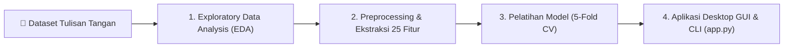

# ✍️ Dysgraphia Handwriting Analyzer (Graphology AI)

Aplikasi dan pipeline berbasis **Computer Vision & Machine Learning** untuk mendeteksi potensi **Disgrafia** (*Dysgraphia*) pada anak melalui analisis karakteristik citra tulisan tangan.

Proyek ini mengekstrak **25 fitur kuantitatif grafologi** (kelurusan garis dasar, inkonsistensi ukuran huruf, kemiringan goresan, getaran/kerutan goresan, kerapatan tinta, dan tekstur GLCM) untuk mengklasifikasikan tulisan tangan ke dalam dua kategori:
* **`Low Potential Dysgraphia`** (Potensi Rendah Disgrafia)
* **`Potential Dysgraphia`** (Potensi Disgrafia)

---

## 📌 Fitur Utama & Alur Kerja Sistem (End-to-End Pipeline)



1. **Exploratory Data Analysis (EDA)**: Analisis kualitas file, validasi integritas citra, sebaran dimensi (*width/height*), rasio aspek, dan keseimbangan kelas.
2. **Feature Engineering & Graphology Extraction**: Mengubah citra tulisan tangan menjadi 25 fitur numerik yang dapat dijelaskan (*Explainable AI*).
3. **Machine Learning Classification**: Pelatihan dan evaluasi komparatif 6 algoritma klasifikasi menggunakan *Stratified 5-Fold Cross Validation*.
4. **Interactive GUI & CLI Application**: Aplikasi pengujian gambar baru yang interaktif dengan visualisasi kartu diagnosis, persentase keyakinan (*confidence score*), dan metrik grafologi utama.

---

## 📊 Karakteristik Dataset

Dataset terdiri dari potongan citra (*strip line*) tulisan tangan anak:

| Kelas / Label | Jumlah Gambar | Persentase | Status Keseimbangan |
|---|---|---|---|
| **`Low Potential Dysgraphia`** | 135 | 54.22% | Seimbang (*Balanced*) |
| **`Potential Dysgraphia`** | 114 | 45.78% | Seimbang (*Balanced*) |
| **Total** | **249** | **100.0%** | **Rasio 1 : 1.18** |

* **Format Citra**: Grayscale / 1-channel (`.jpg`)
* **Dimensi**: Lebar $396 - 1434\text{ px}$ (Median: $1204\text{ px}$), Tinggi $55 - 448\text{ px}$ (Median: $164\text{ px}$)
* **Integritas Data**: $100\%$ valid, $0$ file corrupt, $0$ duplikasi nama file antar kelas.

---

## 🔬 25 Fitur Grafologi & Computer Vision yang Diekstrak

| Kategori Fitur | Nama Fitur | Makna Grafologi & Klinis |
|---|---|---|
| **A. Kelurusan Garis Dasar (*Baseline Stability*)** | `baseline_dev_std`<br>`baseline_waviness` | Mengukur seberapa bergelombang atau naik-turun baris tulisan tangan anak (*ketidakmampuan mempertahankan garis horizontal yang stabil*). |
| **B. Inkonsistensi Ukuran Huruf (*Letter Size Variability*)** | `height_mean`, `height_std`<br>`height_cov`<br>`width_mean`, `width_std`<br>`width_cov`<br>`aspect_ratio_char_mean`<br>`aspect_ratio_char_std` | Mengukur variabilitas dimensi karakter. Nilai **Coefficient of Variation (`height_cov`)** yang tinggi menunjukkan ukuran huruf tidak seragam dalam satu kalimat. |
| **C. Kemiringan Tulisan (*Slant Angle*)** | `slant_angle_mean`<br>`slant_angle_std` | Dihitung dari orientasi gradien Sobel goresan vertikal. Variasi kemiringan (`slant_angle_std`) tinggi menunjukkan arah condong tulisan yang acak/tidak konsisten. |
| **D. Kerapatan Tinta & Spasi (*Spacing & Density*)** | `ink_density`<br>`inter_comp_spacing_mean`<br>`inter_comp_spacing_std`<br>`num_components_density` | Mengukur proporsi tinta terhadap area tulisan serta ketidakteraturan jarak spasi antar kata/karakter. |
| **E. Kualitas Goresan (*Stroke Tremor & Roughness*)** | `stroke_roughness_mean`<br>`stroke_roughness_std`<br>`stroke_thickness_mean`<br>`stroke_thickness_std` | Menggunakan rasio isoperimetrik kontur $\frac{P^2}{4\pi A}$ dan *Distance Transform* untuk mendeteksi kerutan goresan pena akibat tangan gemetar (*tremor*) serta fluktuasi tekanan pena. |
| **F. Tekstur Spasial (*GLCM Features*)** | `glcm_contrast`<br>`glcm_dissimilarity`<br>`glcm_homogeneity`<br>`glcm_energy`<br>`glcm_correlation` | Mengukur keseragaman dan kontras pola intensitas abu-abu pada goresan tinta. |

---

## 🏆 Hasil Evaluasi Perbandingan Model (Stratified 5-Fold CV)

Seluruh model dievaluasi secara ketat menggunakan *Stratified 5-Fold Cross Validation* pada dataset fitur:

| Peringkat | Algoritma Klasifikasi | Akurasi (Mean ± Std) | F1-Score | ROC-AUC |
|:---:|---|:---:|:---:|:---:|
| 🥇 **1** | **Random Forest Classifier** | **82.31% ± 3.56%** | **85.0%** | **88.40%** |
| 🥈 **2** | **Support Vector Machine (SVM RBF)** | **81.91% ± 2.96%** | **84.3%** | **87.56%** |
| 🥉 **3** | **Extra Trees Classifier** | **82.29% ± 5.59%** | **84.8%** | **87.90%** |
| 4 | **K-Nearest Neighbors (KNN)** | 80.73% ± 1.55% | 83.1% | 86.22% |
| 5 | **Gradient Boosting** | 79.89% ± 5.19% | 82.2% | 88.43% |
| 6 | **Logistic Regression** | 79.88% ± 6.27% | 82.0% | 87.55% |

> Model terbaik terpilih (**Random Forest**) disimpan ke dalam berkas `best_dysgraphia_model.pkl`.

---

## 📁 Struktur Direktori Proyek

```text
├── Low Potential Dysgraphia/             # Dataset citra kelas Low Potential (135 citra)
├── Potential Dysgraphia/                 # Dataset citra kelas Potential Dysgraphia (114 citra)
│
├── EDA_Dysgraphia_Dataset.ipynb          # Notebook Tahap 1: Eksplorasi Data Awal (EDA)
├── Feature_Extraction_Dysgraphia.ipynb   # Notebook Tahap 2: Ekstraksi 25 Fitur & Uji Statistik
├── Model_Training_and_Inference.ipynb    # Notebook Tahap 3: Pelatihan Model, CV, & Evaluasi
│
├── dysgraphia_features.csv               # Dataset tabular 25 fitur hasil ekstraksi
├── best_dysgraphia_model.pkl             # Model Random Forest terlatih
├── dysgraphia_scaler.pkl                 # Scaler standarisasi fitur (StandardScaler)
├── feature_names.json                    # Metadata urutan nama-nama fitur
│
├── app.py                                # Aplikasi Desktop GUI & CLI testing citra
└── README.md                             # Dokumentasi proyek
```

---

## 🚀 Panduan Penggunaan & Instalasi

### 1. Prasyarat (*Prerequisites*)
Pastikan Python 3.9+ telah terpasang di sistem Anda. Pasang dependensi yang dibutuhkan:

```bash
pip install numpy pandas matplotlib seaborn pillow opencv-python scikit-image scikit-learn scipy joblib
```

---

### 2. Menjalankan Aplikasi Desktop (GUI Mode)

Jalankan perintah berikut pada terminal di folder proyek:

```bash
python app.py
```

* Klik tombol **`📂 Pilih Gambar Tulisan Tangan...`** untuk memilih file gambar (`.jpg`, `.jpeg`, `.png`).
* Sistem akan memproses gambar secara otomatis dan menampilkan:
  * Pratinjau citra asli.
  * Status Badge Diagnosis: `🟢 POTENSI RENDAH DISGRAFIA` atau `🔴 POTENSI DISGRAFIA`.
  * Skor Keyakinan Model (*Confidence Score*).
  * Metrik Indikator Grafologi Utama (*Baseline Waviness*, *Height Variation*, *Slant Variation*, *Stroke Roughness*, *Ink Density*).

---

### 3. Menjalankan via Terminal (CLI Mode)

Untuk menguji satu file gambar secara cepat tanpa membuka GUI:

```bash
python app.py "Potential Dysgraphia/PD (1).jpg"
```

---

### 4. Menjalankan Jupyter Notebook

Untuk meninjau proses penelitian dan visualisasi secara bertahap:

```bash
jupyter notebook
```

Buka salah satu notebook sesuai urutan:
1. `EDA_Dysgraphia_Dataset.ipynb`
2. `Feature_Extraction_Dysgraphia.ipynb`
3. `Model_Training_and_Inference.ipynb`

---

## 💡 Manfaat & Keunggulan Pendekatan

1. **Explainable AI (XAI)**: Tidak hanya memberikan label prediksi, tetapi juga menyajikan alasan kuantitatif (misal: tulisan diklasifikasikan berpotensi disgrafia karena deviasi garis dasar tinggi atau variasi ukuran huruf tidak konsisten).
2. **Robust pada Dataset Terbatas**: Pendekatan fitur domain grafologi terhindar dari *overfitting* yang umum terjadi jika memaksakan model *deep learning end-to-end* pada dataset skala ratusan gambar.
3. **Praktis & Ringan**: Model dan pipeline ekstraksi berjalan sangat cepat (< 0.1 detik per citra) tanpa memerlukan GPU.
